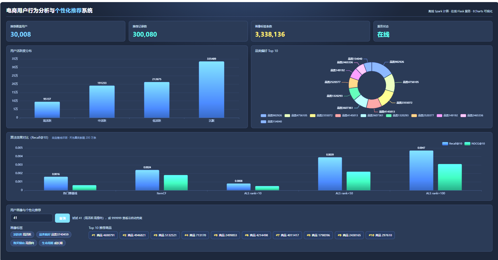
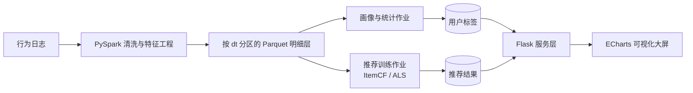

# 电商用户行为分析与个性化推荐系统

> 基于 Hadoop + Hive + Spark 的电商用户行为分析与个性化推荐系统（本科毕业设计）

基于真实的电商用户行为日志，构建 **数据清洗 → 用户画像 → 个性化推荐 → 服务接口 → 可视化** 的完整链路。系统采用离线批处理生成推荐结果、在线服务只查预计算结果的架构，兼顾数据规模与接口响应。

## 功能特性

- **数据链路**：PySpark 完成清洗与特征工程，按日期分区写 Parquet（设计上支持 HDFS / Hive，本地以本地文件系统运行）
- **用户画像**：活跃度、品类偏好、购买倾向、生命周期 4 个维度标签（性别/年龄/价格敏感度在提供维表时启用）
- **统计分析**：PV/UV、品类排行、转化漏斗、复购率
- **个性化推荐**：ItemCF 与 ALS（矩阵分解）双算法召回，新用户走热门榜兜底
- **离线评测**：Recall@10 / NDCG@10 / Coverage 三项指标，支持算法与隐因子维度对比
- **服务与展示**：Flask RESTful 接口 + ECharts 可视化大屏

## 界面预览



> 数据来自天池 UserBehavior 抽样 200 万条行为记录（30,008 名活跃用户、300,080 条推荐、333 万条画像标签）。
> 顶部：核心指标与服务状态；中部：用户活跃度分布、品类偏好 Top 10；
> 下部：热门基线与 ItemCF、ALS（10 / 50 / 100 维）的 Recall@10 与 NDCG@10 对比；
> 最下方：按用户 ID 查询画像标签与 Top 10 推荐商品。

## 技术栈

| 层次 | 技术 |
|---|---|
| 存储 | Parquet 按 dt 分区（本地 / HDFS 均可）、MySQL（建表脚本） |
| 计算 | Spark 4.2 / PySpark |
| 建模 | Spark MLlib（ALS）、pandas、NumPy |
| 服务 | Flask |
| 前端 | HTML + ECharts |
| 部署 | Windows 本地单机（`local[4]`），Docker 方案见 `docker/` |

## 系统架构



离线与在线分离：耗时计算全部离线完成，推荐结果预计算落盘，在线接口只做查询。
（`sql/` 下的 Hive / MySQL 建表脚本对应论文 4.3 节的库表设计，本地实验以 Parquet 为准。）

## 快速开始

### 环境要求

- JDK 17、Python 3.10+（实测 Python 3.13 + pyspark 4.2）
- 本地运行只需 `pip install pyspark pandas pyarrow flask`，不需要 Hadoop/Hive 集群
- 内存 8GB 以上（200 万条数据、`local[4]`）
- 可选：Hadoop 3.3.x + Hive 3.1.x（若要跑 `sql/hive_ddl.sql` 的建表脚本）

### 步骤

```bash
# 1. 安装依赖
pip install -r requirements.txt

# 2. 初始化数据库
mysql -u root -p < sql/mysql_ddl.sql
hive -f sql/hive_ddl.sql

# 3. 准备数据（见 data/README.md，不要将原始数据提交到仓库）
#    将行为日志放入 data/raw/

# 4. 提交清洗作业
spark-submit spark_jobs/clean.py \
    --input data/raw/user_behavior.csv \
    --output /warehouse/ecommerce/ods/behavior_log

# 5. 启动服务
python server/app.py
```

### Windows 一键运行

清洗、画像、召回、ALS 都可以用同一个脚本跑（输出先写到临时目录，成功后再拷回项目）：

```powershell
powershell -ExecutionPolicy Bypass -File .\run_job.ps1 -Job clean     # CSV -> 分区 Parquet
powershell -ExecutionPolicy Bypass -File .\run_job.ps1 -Job profile   # 用户画像标签
powershell -ExecutionPolicy Bypass -File .\run_job.ps1 -Job itemcf    # ItemCF 召回 + 评测
powershell -ExecutionPolicy Bypass -File .\run_job.ps1 -Job als       # ALS 召回 + 参数实验
```

### 启动推荐服务

```powershell
python -m pip install flask pandas pyarrow
powershell -ExecutionPolicy Bypass -File .\run_server.ps1
```

```bash
curl http://127.0.0.1:8000/api/recommend/123?top=10
curl http://127.0.0.1:8000/api/profile/123
curl http://127.0.0.1:8000/api/stats
```

服务只读离线预计算的结果，不做在线计算，对应论文 4.1 节的「离线/在线分离」架构。

## 实验结果

> 数据：阿里天池 UserBehavior（淘宝用户行为）抽样 200 万条，覆盖 2017-11-24 ~ 2017-12-03。
> 过滤交互 <5 次的用户与曝光 <10 次的商品后：交互 43,364 条、用户 30,008、候选商品 2,669。
> 按时间切分：前 8 天训练、后 2 天测试（切分点 2017-12-03）；正样本取测试期的加购与下单行为；N=10。

| 算法 | Recall@10 | NDCG@10 | Coverage |
|---|---|---|---|
| 热门榜单（基线） | 0.0016 | 0.0006 | 0.0037 |
| ItemCF | 0.0024 | 0.0018 | 0.9981 |
| ALS rank=10 | 0.0008 | 0.0005 | 0.1263 |
| ALS rank=50 | 0.0039 | 0.0022 | 0.8018 |
| ALS rank=100 | 0.0047 | 0.0031 | 1.0000 |
| **ALS rank=200（最优）** | **0.0055** | **0.0031** | 1.0000 |

三项结论：

1. **个性化优于热门榜**：ItemCF 的 Recall 是基线的 1.5 倍，ALS 最优是基线的 **3.4 倍**；
2. **隐因子模型优于邻域模型**：ALS（rank=200）约为 ItemCF 的 **2.3 倍**，说明隐式反馈建模比共现相似度更能刻画稀疏交互；
3. **维度收益递减但未过拟合**：10 → 50 → 100 → 200 的增量分别为 +0.0031、+0.0008、+0.0008（相对提升 +20%、+17%），
   边际收益在下降，但尚未出现回落——真实数据的用户偏好维度高于合成数据，需要更高的隐因子空间。

### 参数实验：隐因子维度的影响

| 隐因子维度 | 10 | 50 | 100 | 200 |
|---|---|---|---|---|
| Recall@10 | 0.0008 | 0.0039 | 0.0047 | **0.0055** |
| NDCG@10 | 0.0005 | 0.0022 | 0.0031 | 0.0031 |
| Coverage | 0.1263 | 0.8018 | 1.0000 | 1.0000 |

维度从 10 增到 200 时 Recall 持续提升（0.0008 → 0.0055，约 7 倍），但增量逐步收窄；
rank=100 起覆盖率已达 100%，继续增大维度只提升排序质量、不扩大覆盖面。

> 说明：真实数据上 Recall 绝对值偏低（0.16%–0.47%）是数据集特性——2,669 个候选商品、Top-10 推荐、测试期跨度 2 天，
> 且正样本仅 1,277 条。**评测的关键是与基线的相对提升**，而非绝对值。
> 合成样本上的结果（Recall 0.0539）不可用于论文，仅用于验证代码链路。

### 接口性能（本机 Windows · Flask 开发服务器）

| 接口 | 并发 | 吞吐 | P50 | P95 |
|---|---|---|---|---|
| `/api/recommend/{id}?top=10` | 20 | 731 req/s | 27.0 ms | 28.9 ms |
| `/api/stats`（优化前） | 10 | 2.0 req/s | 4923 ms | 5706 ms |
| `/api/stats`（加缓存，冷启动 1 次） | 1 | — | 775 ms | — |
| `/api/stats`（加缓存，命中） | 10 | 270 req/s | 36.4 ms | 41.5 ms |

`/api/stats` 原本每次请求都重算 333 万条标签的分布，改成首次计算后缓存，单请求从约 5 秒降到 13 毫秒。
压测脚本：`python tools/bench.py --path "/api/stats" --concurrency 10`。

## 目录结构

```
.
├── docker/            # Docker Compose 与集群配置（规划）
├── sql/               # Hive / MySQL 建表脚本
├── spark_jobs/        # PySpark 作业（clean / user_profile / itemcf / als）
├── tools/             # 数据集抽样工具
├── server/            # Flask 服务层
├── web/               # ECharts 大屏（单页）
├── data/              # 数据说明与小样本（原始数据不入库）
├── docs/              # 系统实现与实验报告
├── screenshots/       # 系统截图
├── run_job.ps1        # 一键运行离线作业
└── run_server.ps1     # 一键启动服务
```

## 开发进度

- [x] 需求分析与系统设计
- [x] 数据库与数据仓库模型设计
- [x] PySpark 数据清洗作业
- [x] 用户画像标签计算（活跃度 / 品类偏好 / 购买倾向 / 生命周期）
- [x] ItemCF 召回与离线评测（Recall@10 / NDCG@10 / Coverage）
- [x] ALS 训练与参数实验（rank 10/50/100/200，最优 rank=200，收益边际递减）
- [x] Flask 推荐接口（推荐 / 画像 / 统计）
- [x] ECharts 可视化大屏
- [x] 补跑 ALS rank=200，维度收益边际递减
- [x] 结果落库（SQLite 实测：推荐 30,008 行 + 标签 3,338,136 行；MySQL 脚本就绪，待实例）
- [x] 接口性能压测（`tools/bench.py`，统计接口加缓存后 P95 30ms）
- [x] 冷启动与多样性分析（Top-10 平均覆盖 6.58 个类目，单一类目占比 0.31）

## 数据说明

数据来源、字段定义与获取方式见 [data/README.md](data/README.md)。**原始数据集不纳入版本管理**，仓库仅保留小样本用于跑通流程。

## 相关文档

- [系统实现与实验报告](docs/系统实现与实验报告.md)：章节对照、算法口径、评测结果、工程问题记录
- 毕业设计论文：`docs/thesis.pdf`（定稿后补充）

## License

本项目仅用于学习与毕业设计，数据集版权归原始发布方所有。
