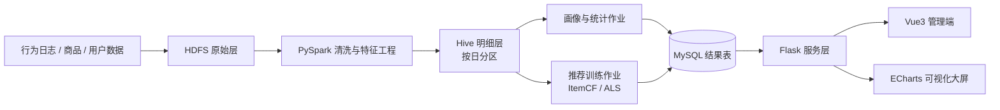

# 电商用户行为分析与个性化推荐系统

> 基于 Hadoop + Hive + Spark 的电商用户行为分析与个性化推荐系统（本科毕业设计）

基于真实的电商用户行为日志，构建 **数据清洗 → 用户画像 → 个性化推荐 → 服务接口 → 可视化** 的完整链路。系统采用离线批处理生成推荐结果、在线服务只查预计算结果的架构，兼顾数据规模与接口响应。

## 功能特性

- **数据链路**：原始日志落 HDFS，PySpark 完成清洗与特征工程，按日期分区写入 Hive 明细表
- **用户画像**：基础属性、活跃度、品类偏好、价格敏感度、生命周期 5 个维度标签
- **统计分析**：PV/UV、品类排行、转化漏斗、复购率
- **个性化推荐**：ItemCF 与 ALS（矩阵分解）双算法召回，冷启动兜底与多样性重排
- **离线评测**：Precision / Recall / Coverage / Diversity 四项指标，支持算法与参数对比
- **服务与展示**：Flask RESTful 接口 + Vue3 管理端 + ECharts 可视化大屏

## 技术栈

| 层次 | 技术 |
|---|---|
| 存储 | Hadoop HDFS、Hive、MySQL、Redis |
| 计算 | Spark 3.5 / PySpark |
| 建模 | pandas、NumPy、scikit-learn、implicit（ALS） |
| 服务 | Flask |
| 前端 | Vue3 + Element Plus + ECharts |
| 部署 | Docker / Docker Compose，Linux 单机伪分布式 |

## 系统架构



离线与在线分离：耗时计算全部离线完成，推荐结果预计算入库，在线接口只做查询。

## 快速开始

### 环境要求

- JDK 8 / 11、Python 3.10+
- Hadoop 3.3.x、Hive 3.1.x、Spark 3.5.x、MySQL 8.0
- 内存 16GB 以上（单机伪分布式）

### 步骤

```bash
# 1. 安装依赖
pip install -r requirements.txt

# 2. 初始化数据库
mysql -u root -p < sql/mysql_ddl.sql
hive -f sql/hive_ddl.sql

# 3. 准备数据（见 data/README.md，不要将原始数据提交到仓库）
#    将行为日志放入 data/raw/

# 4. 提交清洗作业
spark-submit spark_jobs/clean.py \
    --input data/raw/user_behavior.csv \
    --output /warehouse/ecommerce/ods/behavior_log

# 5. 启动服务
python server/app.py
```

## 实验结果

> 数据：合成样本 12 万条行为记录、19,947 名用户、5,000 件商品（9 天，含潜在品类偏好）。
> 按时间切分：前 7 天训练、后 2 天测试；正样本取测试期的加购与下单行为；推荐列表长度 N=10。

| 算法 | Recall@10 | NDCG@10 | Coverage |
|---|---|---|---|
| 热门榜单（基线） | 0.0038 | 0.0025 | 0.0020 |
| ItemCF | **0.0267** | **0.0121** | 1.0000 |
| ALS（矩阵分解） | 待补 | 待补 | 待补 |

ItemCF 的 Recall@10 是热门基线的约 7 倍，说明协同过滤确实捕捉到了用户-商品之间的共现结构。

参数实验（ALS 隐因子维度）：待补。

> 说明：以上为合成数据上的流程验证结果，用于确认代码链路正确；论文中的正式数值需在
> 阿里天池 UserBehavior 真实数据集上重新跑测后填入。

## 目录结构

```
.
├── docker/            # Docker Compose 与集群配置
├── sql/               # Hive / MySQL 建表脚本
├── spark_jobs/        # PySpark 作业（清洗、画像、训练）
├── eval/              # 离线评测脚本与结果
├── server/            # Flask 服务层
├── web/               # Vue3 前端
├── data/              # 数据说明与小样本（原始数据不入库）
├── docs/              # 设计文档、架构图、实验记录
└── screenshots/       # 系统截图
```

## 开发进度

- [x] 需求分析与系统设计
- [x] 数据库与数据仓库模型设计
- [x] PySpark 数据清洗作业
- [x] 用户画像标签计算（活跃度 / 品类偏好 / 购买倾向 / 生命周期）
- [x] ItemCF 召回与离线评测（Recall@10 / NDCG@10 / Coverage）
- [ ] ALS 训练与参数实验
- [ ] Flask 推荐接口
- [ ] Vue3 管理端与可视化大屏
- [ ] 性能测试与论文数据替换

## 数据说明

数据来源、字段定义与获取方式见 [data/README.md](data/README.md)。**原始数据集不纳入版本管理**，仓库仅保留小样本用于跑通流程。

## 相关文档

- 系统设计说明：`docs/`
- 毕业设计论文：`docs/thesis.pdf`（定稿后补充）

## License

本项目仅用于学习与毕业设计，数据集版权归原始发布方所有。
